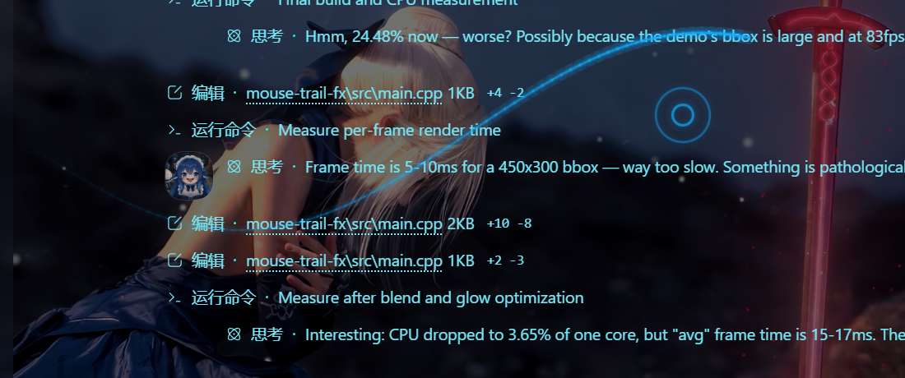
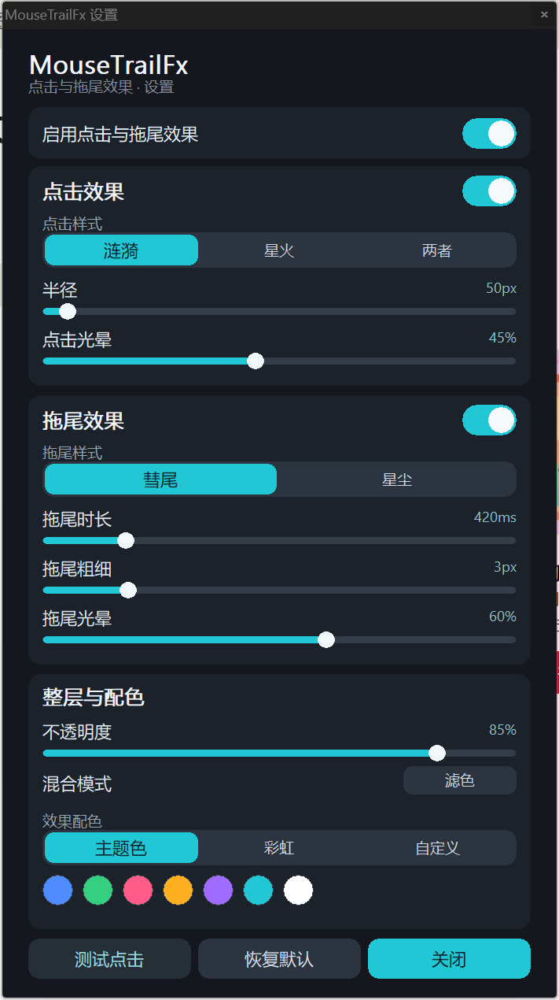

# MouseTrailFx

Windows 桌面上的「点击涟漪 + 光标拖尾」小工具：单文件、零依赖、空闲不耗 CPU。



## 特性

- **拖尾**：彗尾（连续光带）与星尘（离散亮点）两种样式，按年龄收细、淡出
- **点击**：涟漪 / 星火 / 两者，双层圆环 + 中心白闪
- **参数**：半径、光晕、时长、粗细、不透明度、混合档、配色（主题色 / 彩虹 / 自定义）
- **性能**：空闲 0 帧 0 CPU；只覆盖活跃区域的动态尺寸分层窗口；帧耗时 ~1ms
- **易用**：托盘常驻、自绘设置面板、配置文件热更新、开机自启、桌面/开始菜单快捷方式
- **不打扰**：鼠标穿透、不抢焦点、不进 Alt-Tab；截图/录屏时默认隐藏（可关）

## 界面



## 构建

需要 [MinGW-w64](https://www.mingw-w64.org/)（`g++`、`windres`）：

```powershell
powershell -ExecutionPolicy Bypass -File build.ps1
```

产物：`dist\MouseTrailFx.exe`（约 500 KB，静态链接，无需运行库）。

手动编译：

```powershell
windres app.rc -O coff -o build_res.o
g++ -std=c++20 -O2 -s -municode -mwindows -static src/main.cpp build_res.o -o dist\MouseTrailFx.exe `
    -lgdi32 -luser32 -lwinmm -lshell32 -lole32 -luuid
```

## 使用

| 操作 | 说明 |
|---|---|
| 双击 exe / 快捷方式 | 弹出设置面板（已在运行时则把面板叫到前台） |
| 托盘图标双击 | 打开设置面板 |
| `Ctrl+Alt+P` | 打开设置面板 |
| `Ctrl+Alt+F` | 开关特效 |
| `Ctrl+Alt+Q` | 退出 |

托盘右键菜单：启用效果、预设（默认/霓虹/极简/星尘）、设置、打开配置文件、开机自启、创建桌面快捷方式、截图时隐藏特效、退出。

## 配置

`%APPDATA%\MouseTrailFx\config.json`，改完 300ms 内生效：

```json
{
  "enabled": true,
  "autostart": true,
  "captureHidden": true,
  "opacity": 85,
  "blend": "screen",
  "click": { "on": true, "style": "ripple", "size": 50, "glow": 45 },
  "trail": { "on": true, "style": "comet", "length": 420, "width": 3.0, "glow": 60 },
  "color": { "mode": "accent", "value": "#4f8cff" }
}
```

- `click.style`：`ripple` / `spark` / `both`
- `trail.style`：`comet` / `dust`
- `blend`：`screen` / `normal` / `overlay` / `multiply` / `lighten`
- `color.mode`：`accent`（跟随系统强调色）/ `rainbow` / `custom`
- `captureHidden`：`true` 时截图与录屏看不到特效

## 实现要点

绘制数学不是拍脑袋调出来的，而是从壁纸引擎插件 `dsh-plugin-wallpaper-engine-fx` v1.4.0（MIT）
逐行逆向出来的：

| 参数 | 值 | 来源 |
|---|---|---|
| 拖尾采样间距 | 3 px（距离重采样） | `FX_TRAIL_STEP_PX` |
| 拖尾寿命 | 420 ms（可调 80–2000） | `fxTrailLength` |
| 点击寿命 | 900 ms | `FX_CLICK_LIFE_MS` |
| 涟漪 | 两圈，第二圈晚 18%，`easeOutCubic` | `fxDrawClicks` |
| 星火 | 12 条，外 30% 长度，前 1/3 寿命白闪 | `FX_SPARK_COUNT` |

差别在于底座：插件画在应用内的 Canvas 上，这里换成 **Win32 分层窗口 + 自写 SDF 光栅器**：

- 预乘 ARGB 画到 DIB，`UpdateLayeredWindow` 上屏
- 窗口尺寸 = 活跃粒子包围盒（量化 64px），空闲即隐藏
- 光晕不是 `shadowBlur`，而是多遍递减 alpha 的描边（近似高斯），CPU 可承受
- 锁只保护「老化 + 拷贝」，绘制与上屏在锁外（避免与窗口线程互相等待）
- 自愈巡检：窗口被隐藏 / 丢 topmost / 分辨率变化时自动恢复

## 实测（2560×1600 @150%）

| 指标 | 结果 |
|---|---|
| 空闲 CPU | 0 % |
| 持续动画 CPU | 3–8 % 单核 |
| 帧耗时 | ~0.5–1 ms |
| 内存 | 24–34 MB（DIB 占大头） |
| exe | ~500 KB |

## 已知限制

1. **混合模式是近似**：拿不到桌面像素，`screen` 用提亮 + 加色逼近。
2. **未签名**：首次运行可能触发 SmartScreen「未知发布者」。要彻底消除需要代码签名证书；
   `tools\unblock.ps1` 可去掉下载文件的网络标记。
3. **截图排除依赖系统**：`WDA_EXCLUDEFROMCAPTURE` 需要 Windows 10 2004+。
4. 多显示器混合 DPI 未逐屏验证；光晕是多遍描边近似，不是真高斯。

## 目录

```
src/main.cpp        全部实现
app.rc / app.ico    图标与版本信息
build.ps1           构建脚本
docs/               截图
tools/              图标生成、快捷方式、解除锁定等辅助脚本
```

## 许可

[MIT](LICENSE)。绘制参数来自同样以 MIT 发布的 `dsh-plugin-wallpaper-engine-fx`，版权归其作者。
