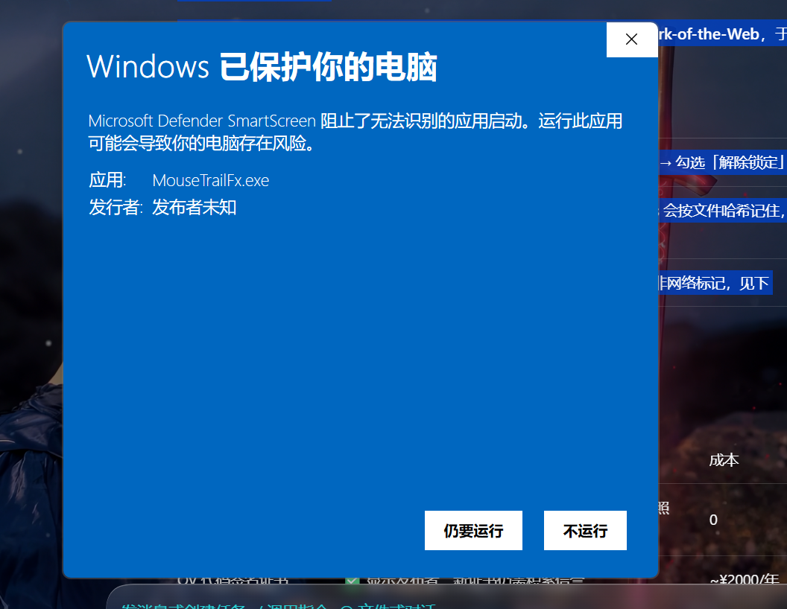
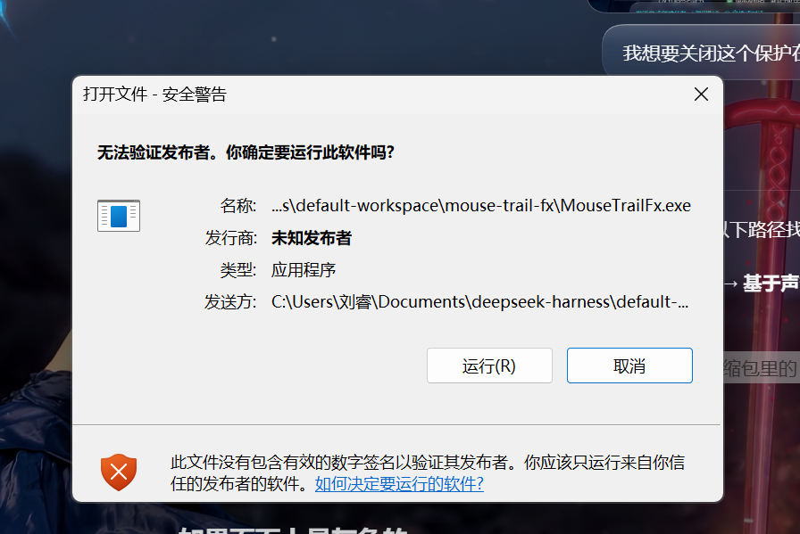

# 首次运行提示说明

从网上下载 `MouseTrailFx.exe` 后第一次双击，Windows 可能会拦一下。这是**微软对未签名程序的常规提示**，不是病毒告警。

## 可能看到的第一种：蓝色 SmartScreen



> Windows 已保护你的电脑 / Microsoft Defender SmartScreen 阻止了无法识别的应用启动
> 应用：MouseTrailFx.exe　发行者：发布者未知

**处理**：点「**更多信息**」，再点「**仍要运行**」。

这是一次性的——Windows 会按文件哈希记住这个选择，同一个版本不会再问。升级到新版本后哈希变了，会再问一次。

## 可能看到的第二种：灰色安全警告



> 无法验证发布者。你确定要运行此软件吗？

**处理**：点「**运行**」。如果窗口里有「打开此文件前总是询问」的勾选项，取消勾选即可。

## 为什么会提示

三个因素叠加，缺一不可：

| 因素 | 说明 |
|---|---|
| **文件带了「来自 Internet」标记** | 浏览器/聊天工具保存的文件会被打上 Mark-of-the-Web，Windows 对这类文件更谨慎 |
| **exe 没有代码签名** | 代码签名证书年费较高，这个项目没有购买，所以显示「未知发布者」 |
| **没有信誉记录** | SmartScreen 按文件哈希和证书积累信誉，新发布的小众程序天然是零信誉 |

三者的结果就是：Windows 认不出发布者，也没有“这个文件很多人用过”的记录，于是让你自己确认一次。

## 三种消除方式

### 方式一：直接点「仍要运行」（最简单）

不需要改任何设置，仅对这一个文件生效，不影响系统其它防护。

### 方式二：解除文件锁定（推荐）

右键 `MouseTrailFx.exe` → **属性** → 在「常规」页最下方勾选「**解除锁定**」→ 确定。

或者用 PowerShell：

```powershell
Unblock-File .\MouseTrailFx.exe
```

这两种做法都会去掉文件的「来自 Internet」标记，之后双击不再提示。

> 注意：要操作的是 **exe 本体**（类型显示为“应用程序”），不是桌面快捷方式（类型“快捷方式 (.lnk)”），快捷方式属性里没有「解除锁定」。

### 方式三：关闭系统级拦截（不推荐）

关闭 SmartScreen 的「检查应用和文件」会让**所有**未识别程序都不再提示，防护会整体下降。除非你明确知道后果，否则不建议。

## 如何确认文件没被篡改

Release 页面附了 SHA-256。下载后可以自己核对：

```powershell
Get-FileHash .\MouseTrailFx.exe -Algorithm SHA256
```

和 Release 说明里的值一致即可。

也可以直接[从源码构建](https://github.com/LRxfl0019/MouseTrailFx#从源码构建)——本地编译出来的文件没有网络标记，不会有任何提示。

## 这个程序会做什么

如果你对“未知发布者”仍有顾虑，可以核对它的行为范围：

- 不联网、不上传任何数据
- 不请求管理员权限，不安装服务/驱动
- 只写三个地方：`%APPDATA%\MouseTrailFx\config.json`（配置）、可选的 `HKCU\...\Run`（开机自启）、可选的桌面/开始菜单快捷方式
- 使用全局鼠标钩子读取光标位置与左键（拖尾/点击效果的必要条件），不注入其它进程、不记录键盘

源码只有 `src/main.cpp` 一个文件，全部可用。

## 卸载

托盘右键 →「开机自启」取消勾选 →「退出」，然后删除：

- `MouseTrailFx.exe`
- 桌面与开始菜单里的 `MouseTrailFx.lnk`
- `%APPDATA%\MouseTrailFx\` 目录
